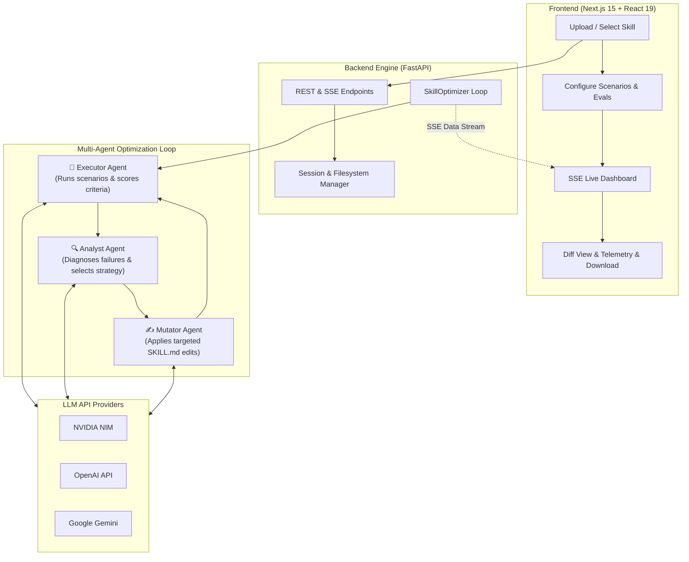
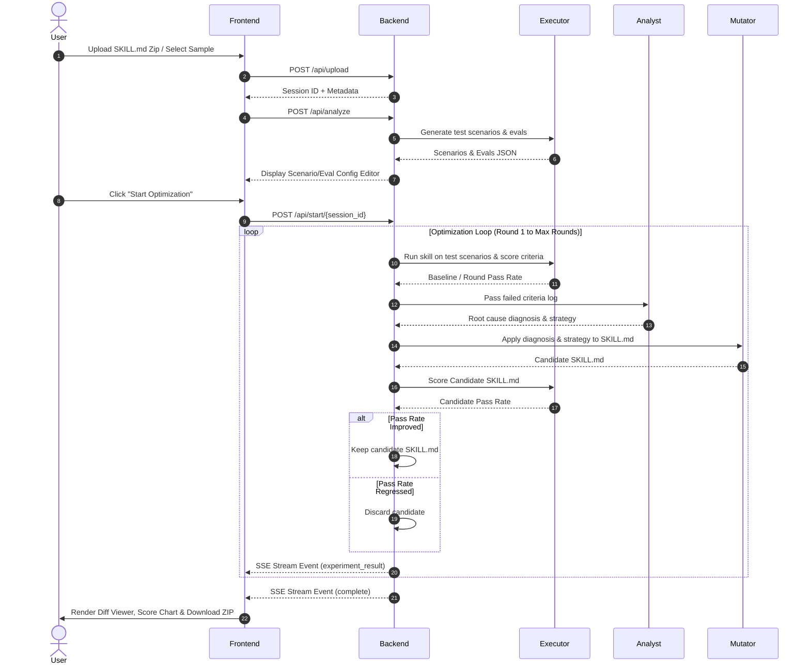

# 🤖 Self-Improving Agent

[](LICENSE)
[](https://www.python.org/)
[](https://fastapi.tiangolo.com/)
[](https://nextjs.org/)
[](https://react.dev/)
[](https://tailwindcss.com/)

**Self-Improving Agent** is an autonomous, multi-agent AI framework and interactive web application designed to benchmark, diagnose, and iteratively optimize AI agent skill packages (`SKILL.md`). 

By deploying a closed-loop feedback system powered by specialized agents (**Executor**, **Analyst**, and **Mutator**), the system systematically discovers prompt vulnerabilities, tests candidates against rigorous evaluation suites, and evolves skills to maximize accuracy and instruction compliance.

---

## 📑 Table of Contents

- [Key Features](#-key-features)
- [System Architecture](#-system-architecture)
- [Repository Structure](#-repository-structure)
- [Prerequisites](#-prerequisites)
- [Quick Start Guide](#-quick-start-guide)
  - [1. Backend Setup](#1-backend-setup)
  - [2. Frontend Setup](#2-frontend-setup)
- [Configuration & Environment Variables](#-configuration--environment-variables)
- [API Reference](#-api-reference)
- [Optimization Workflow Walkthrough](#-optimization-workflow-walkthrough)
- [Sample Skills](#-sample-skills)
- [Security & Session Management](#-security--session-management)
- [License](#-license)

---

## ✨ Key Features

- **🤖 Multi-Agent Closed Feedback Loop**:
  - **Executor Agent**: Runs candidate skills against complex input scenarios and evaluates generated outputs against strict binary (pass/fail) criteria.
  - **Analyst Agent**: Performs root-cause failure analysis and recommends targeted mutation strategies (`add_example`, `add_constraint`, `restructure`, `add_edge_case`).
  - **Mutator Agent**: Generates precise, minimal structural and prompt modifications while strictly maintaining YAML frontmatter and formatting requirements.
  - **Hill-Climbing Selection**: Accepts mutations that improve baseline benchmark scores and discards regressions.

- **🔌 Flexible Multi-LLM Provider Support**:
  - Direct integration with **NVIDIA NIM** (`integrate.api.nvidia.com`), **OpenAI API**, and **Google Gemini API**.
  - Supports model selection including `meta/llama-3.3-70b-instruct`, `nvidia/nemotron-3.5-lightning-30b-a3b`, `gemini-2.5-flash`, and `gpt-4o`.

- **⚡ Real-Time Streaming Dashboard (Next.js 15 & SSE)**:
  - **Interactive Workflow**: 4-step wizard for Uploading, Customizing Scenarios/Evals, Monitoring Execution, and Analyzing Results.
  - **Server-Sent Events (SSE)**: Live streaming of optimization rounds, experiment decisions (keep/discard), per-criterion pass rates, and status logs.
  - **Rich Visual Analytics**: Integrated score progression charts ([Recharts](https://recharts.org/)), side-by-side git-style diff viewer, strategy efficiency breakdown, and downloadable ZIP archives with structured `CHANGELOG.json`.

- **🛡️ Enterprise-Grade Session Cleanup & Security**:
  - Built-in path traversal safeguards, text-file extension whitelisting, payload size limiting, and automated asynchronous session TTL memory management.

---

## 🏗️ System Architecture

The workflow consists of an interactive web frontend connected to a FastAPI backend streaming optimization state via Server-Sent Events (SSE).



---

## 📁 Repository Structure

```
self-improving-agent/
├── backend/
│   ├── app.py                   # FastAPI application server & REST/SSE routes
│   ├── openai_optimizer.py      # Multi-agent optimization loop & LLM interface
│   ├── requirements.txt         # Python dependencies
│   └── __pycache__/
├── frontend/
│   ├── package.json             # Frontend project dependencies & npm scripts
│   ├── tsconfig.json            # TypeScript configuration
│   ├── postcss.config.mjs       # Tailwind CSS PostCSS plugin setup
│   └── src/
│       ├── app/
│       │   ├── page.tsx         # Main multi-step application view
│       │   ├── layout.tsx       # Root layout wrapper
│       │   └── global.css       # Global styles & Tailwind directives
│       └── components/
│           ├── UploadStep.tsx   # Skill archive upload & sample loader
│           ├── ConfigStep.tsx   # Scenario & Evaluation criteria editor
│           ├── RunningStep.tsx  # Real-time SSE optimization progress UI
│           ├── ResultsStep.tsx  # Side-by-side diff viewer & score analytics
│           ├── StepIndicator.tsx# Wizard progress step bar
│           └── ThemeToggle.tsx  # UI theme switcher
└── sample_skills/
    ├── sql-query-generator/     # Sample skill: SQL query generation & schema guidelines
    │   ├── SKILL.md
    │   └── references/
    └── api-docs-generator/      # Sample skill: OpenAPI/REST documentation builder
        └── SKILL.md
```

---

## 🔧 Prerequisites

Before starting, ensure you have the following installed on your system:

- **Python**: Version `3.10` or higher
- **Node.js**: Version `18.0.0` or higher
- **Package Managers**: `pip` (Python) and `npm` or `pnpm` (Node.js)
- **API Key**: At least one valid API key from **NVIDIA NIM**, **OpenAI**, or **Google Gemini**.

---

## 🚀 Quick Start Guide

### 1. Backend Setup

 Navigate to the `backend` directory, create a Python virtual environment, and install dependencies:

```bash
cd backend

# Create virtual environment
python3 -m venv venv

# Activate virtual environment
# On Linux/macOS:
source venv/bin/activate
# On Windows:
# venv\Scripts\activate

# Install required dependencies
pip install -r requirements.txt
```

Create a `.env` file in the `backend/` directory (optional if providing API keys via the web interface):

```env
# NVIDIA NIM API (Default)
NVIDIA_API_KEY=nvapi-your-key-here
NVIDIA_MODEL=nvidia/nemotron-3.5-lightning-30b-a3b

# OpenAI API (Optional)
OPENAI_API_KEY=sk-your-openai-key-here
OPENAI_MODEL=gpt-4o

# Google Gemini API (Optional)
GEMINI_API_KEY=AIzaSy-your-gemini-key-here
GEMINI_MODEL=gemini-2.5-flash
```

Launch the FastAPI backend server on port `8891`:

```bash
python app.py
# Or using uvicorn directly:
# uvicorn app:app --host 0.0.0.0 --port 8891 --reload
```

The API health check will be available at `http://localhost:8891/health`.

---

### 2. Frontend Setup

Open a new terminal window, navigate to the `frontend` directory, install dependencies, and start the development server:

```bash
cd frontend

# Install Node.js dependencies
npm install

# Start Next.js development server
npm run dev
```

Open your browser and navigate to **`http://localhost:3000`**.

---

## ⚙️ Configuration & Environment Variables

### Backend Environment Variables (`backend/.env`)

| Variable | Type | Description | Default |
| :--- | :--- | :--- | :--- |
| `NVIDIA_API_KEY` | String | NVIDIA NIM API key (`nvapi-...`) | - |
| `NVIDIA_MODEL` | String | NVIDIA model identifier | `nvidia/nemotron-3.5-lightning-30b-a3b` |
| `NVIDIA_BASE_URL` | String | Custom base URL for NVIDIA API | `https://integrate.api.nvidia.com/v1` |
| `OPENAI_API_KEY` | String | OpenAI API key (`sk-...`) | - |
| `OPENAI_MODEL` | String | OpenAI model identifier | `gpt-4o` |
| `OPENAI_BASE_URL` | String | Custom base URL for OpenAI API | `https://api.openai.com/v1` |
| `GEMINI_API_KEY` | String | Google Gemini API key (`AIza...`) | - |
| `GEMINI_MODEL` | String | Gemini model identifier | `gemini-2.5-flash` |
| `GEMINI_BASE_URL` | String | Base URL for Gemini OpenAI endpoint | `https://generativelanguage.googleapis.com/v1beta/openai/` |

### Frontend Environment Variables (`frontend/.env.local`)

| Variable | Type | Description | Default |
| :--- | :--- | :--- | :--- |
| `NEXT_PUBLIC_API_URL` | String | Base URL of the backend FastAPI service | `http://localhost:8891` |

---

## 📡 API Reference

### Core Endpoints

#### `GET /health`
Returns system health status.
- **Response**: `{"status": "healthy"}`

#### `POST /api/upload`
Uploads a `.zip` archive containing `SKILL.md` and reference files.
- **Request**: Multipart Form Data (`file`: `.zip` file)
- **Response**: `{"session_id": "...", "file_list": [...], "metadata": {...}}`

#### `POST /api/upload-files`
Uploads multiple files directly from a directory upload.
- **Request**: Multipart Form Data (`files`: List of files)

#### `GET /api/examples`
Lists pre-configured sample skills available in the repository.
- **Response**: `{"examples": [{"name": "...", "description": "...", "path": "..."}]}`

#### `POST /api/examples/{example_name}/load`
Loads a sample skill directly into a new session.

#### `POST /api/analyze`
Invokes the LLM to inspect the uploaded `SKILL.md` and generate test scenarios & binary evaluation criteria.
- **Body**:
  ```json
  {
    "session_id": "string",
    "api_key": "string (optional)",
    "model": "string (optional)"
  }
  ```

#### `POST /api/update-config`
Saves user-modified scenarios and evaluation criteria.

#### `POST /api/start/{session_id}`
Starts the multi-agent optimization loop as an asynchronous background task.
- **Body**:
  ```json
  {
    "api_key": "string (optional)",
    "model": "string (optional)",
    "max_rounds": 20
  }
  ```

#### `GET /api/stream/{session_id}`
SSE stream for real-time progress updates during optimization.

#### `POST /api/stop/{session_id}`
Requests an immediate cancellation of a running optimization session.

#### `GET /api/download/{session_id}`
Downloads the improved skill package as a `.zip` archive containing the optimized `SKILL.md` and a `CHANGELOG.json`.

---

## 🔄 Optimization Workflow Walkthrough



---

## 🧪 Sample Skills

The repository comes pre-packaged with two production sample skills in `sample_skills/`:

1. **SQL Query Generator (`sample_skills/sql-query-generator/`)**:
   - **Target**: Formulates compliant SQL queries against enterprise schemas while preventing unindexed full table scans and unauthorized table mutations.
   - Includes reference schema documents in `references/`.

2. **API Documentation Generator (`sample_skills/api-docs-generator/`)**:
   - **Target**: Converts unstructured code comments and endpoint handlers into standardized Markdown / OpenAPI specifications with response code tables.

You can try these sample skills immediately from the dashboard by clicking **"Load Sample"** on the upload screen.

---

## 🔒 Security & Session Management

- **Path Traversal Protection**: Rejects zip entries containing `..` or absolute path constructs.
- **Allowed Extension Filtering**: Strictly restricts file processing to plain text formats (`.md`, `.json`, `.yaml`, `.py`, `.ts`, etc.).
- **Size & Count Limits**: Enforces a maximum upload archive limit of 10MB, individual file caps of 1MB, and file count limits of 50.
- **Session Lifecycle & Cleanup**: Backend sessions automatically expire after 1 hour (`SESSION_TTL = 3600`) with periodic background garbage collection every 5 minutes.

---

## 📄 License

Distributed under the MIT License. See `LICENSE` for more information.
